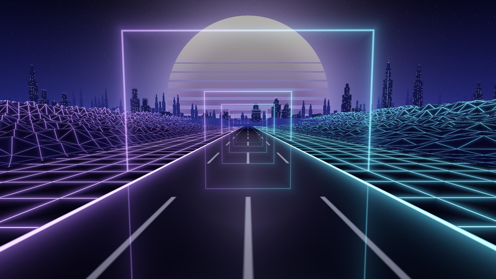
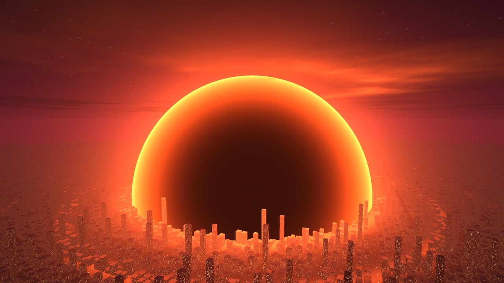
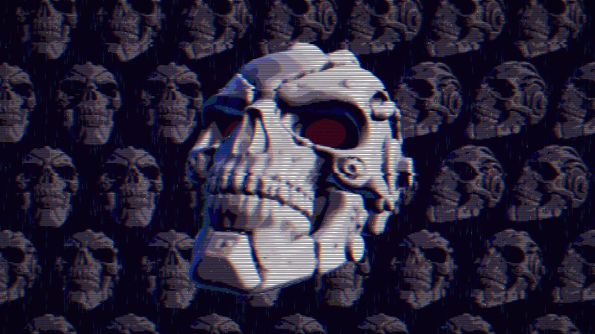
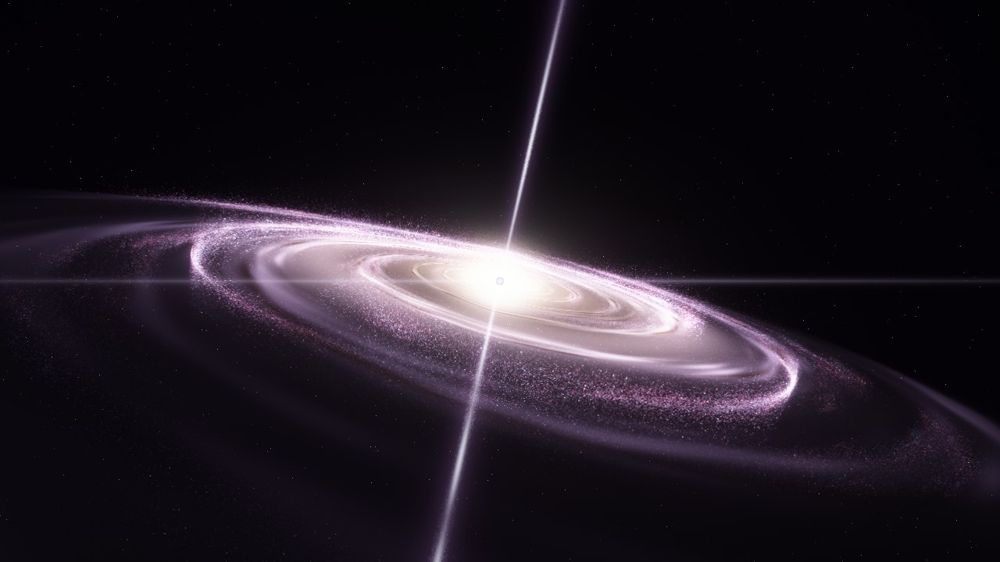
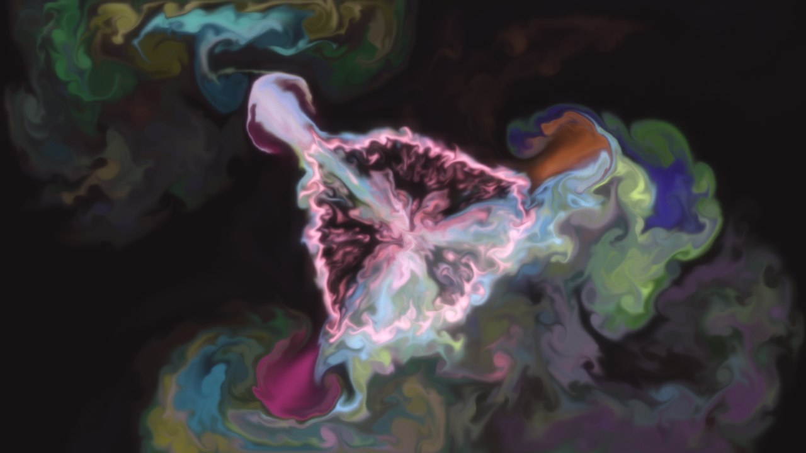

# Visualizer

A modern take on the old Winamp visualisers. It listens to whatever your PC is playing (Spotify, a browser, a game)
and reacts to it: it follows the beat, spots build-ups and drops, and picks colours from the album art.

It's one small `.exe`. There's no installer, and it keeps itself up to date.

**[Download the latest release](https://github.com/gfyans/old-school-visualizer/releases/latest)**

| | |
|---|---|
|  |  |
|  |  |
|  |  |

## Visualisers

* **Nebula**: a flight through a glowing gas cloud.
* **Neon Grid**: a synthwave night drive, with mountains made from the music.
* **Liquid**: ink swirling in water.
* **Oscilloscope**: the waveform on an old CRT.
* **Aurora**: northern lights over a frozen lake.
* **Galaxy**: a million stars round a black hole.
* **Fractal flights**: a flight through endless fractals.
* **Signal**: cyberpunk glitch art.
* **Detonation**: a city at night, waiting for the drop.
* **Glass City**: a flight through cyberspace, a city of glass with currents of light running through it.
* **Spectrum**: a classic spectrum analyser.
* **Dot Field**: 400,000 neon dots on a plane, rising into a landscape made from the music.

## Using it

Right-click anywhere for the menu. Every setting is in there. Press `H` to see the main keys.

| Key | What it does |
|---|---|
| `←` `→` | Previous / next visualiser |
| `↑` `↓` | Play / pause, next track |
| `N` | Next look |
| `Q` | Set off the big moment now, without waiting for a drop |
| `C` | Scene changes: off, one per song, or random |
| `F` | Fullscreen |
| `R` | Record to MP4 |
| `F12` | Screenshot |
| `Esc` | Leave fullscreen, or quit |

**Nothing reacting?** Press `F1`. If it says *(silent)*, your music is playing on a different device. Press `D`
until it picks the right one.

## Streaming with OBS

Press `O` (or right-click › Display › Stream mode) to get the window ready for streaming. The on-screen text goes
and the window becomes 1920 × 1080. There are four stream modes:

* **Clean**: the visualiser, nothing else.
* **Transparent**: the window is see-through where the picture is dark, so the visualiser glows over your game.
* **Equaliser bars, transparent**: only the bars, on a see-through window.
* **Equaliser bars on green**: only the bars, for a chroma key.

For the transparent modes, add a **Window Capture** in OBS, pick the Visualizer window and set **Capture Method** to
**Windows 10 (1903 and up)**. If it shows black where it should be see-through, use a **Game Capture** of the window
with **Allow Transparency** ticked instead. In transparent mode, `F12` saves a screenshot that keeps the transparency.

## Credits

Signal uses three 3D models from Printables:

* [Cyber Skull](https://www.printables.com/model/1260642-cyber-skull) by [Stigern](https://www.printables.com/@Stigern), [CC BY-NC 4.0](https://creativecommons.org/licenses/by-nc/4.0/)
* [Gas Mask Head with Helmet](https://www.printables.com/model/1480313-gas-mask-head-with-helmet) by [Stigern](https://www.printables.com/@Stigern), [CC BY-NC-ND 4.0](https://creativecommons.org/licenses/by-nc-nd/4.0/)
* [Human Brain](https://www.printables.com/model/595502-human-brain) by [Matteo Pascale](https://www.printables.com/@MatteoPascale_650678), [CC BY-NC-SA 4.0](https://creativecommons.org/licenses/by-nc-sa/4.0/)

The models aren't in this repository. The app embeds them, and it's free.

## Building

You need Visual Studio 2022 or later with the C++ desktop workload. Then run:

```powershell
.\build.ps1 -Run
```

Want to make your own? See [Adding a visualiser](docs/adding-a-visualiser.md).
